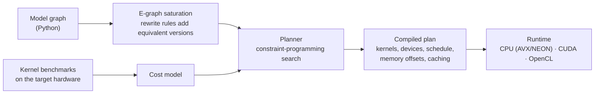

# tensor_graphs

A compiler and inference engine for ML models, written in C++ with Python bindings.

You give it a model as a graph of tensor operations. It works out how to run that graph on your hardware (CPU, GPU, or both): which kernel implements each operation, which device it runs on, in what order, where each tensor lives in memory, and what to cache between runs. Currently implemented: **Gemma 3 270M** (text generation), **EmbeddingGemma** (text and audio embeddings), and an image diffusion model.

> **Status: paused.** Worked on for ~10 months. A compiler is the hard way to get speed; an engine specialized for one model on one piece of hardware gets there faster. Write-up: [endeavoringorb.github.io/projects_html/tensor_graphs.html](https://endeavoringorb.github.io/projects_html/tensor_graphs.html).

## How it works



**1. Rewriting with e-graphs.** The model graph goes into an [e-graph](https://egraphs-good.github.io/), a data structure that stores many equivalent versions of a computation at once. Rewrite rules add alternatives: fusing small operations into one kernel, running an operation on another device (with the copies that requires), or recomputing only the part of a tensor that changed since the last call, so results can be cached across calls (e.g. token-by-token generation).
→ [`core/egraph.hpp`](tensor_graphs_cpp/core/egraph.hpp), [`core/rewrite.hpp`](tensor_graphs_cpp/core/rewrite.hpp)

**2. Planning as a search problem.** Choosing the best version out of the e-graph is combinatorial, so the planner is a constraint-programming search (branch and bound with propagators). For every operation it decides which implementation to use, when and on which device it runs (CPU and GPU run concurrently), where its output goes in memory (buffers that are never alive at the same time share space), and whether to keep it cached for the next run. The objective is simulated run time. Lower bounds on the best achievable run time let whole branches be pruned once they provably cannot beat the best plan found so far.
→ [`core/plan/search_engine.hpp`](tensor_graphs_cpp/core/plan/search_engine.hpp), [`core/plan/propagators/`](tensor_graphs_cpp/core/plan/propagators), [`core/plan/relaxation_bound.hpp`](tensor_graphs_cpp/core/plan/relaxation_bound.hpp), [design notes](docs/notes/search_redesign.md)

**3. Testing the search.** A search like this is easy to get subtly wrong, so an *oracle* suite brute-forces small planning problems in Python and checks that the C++ search finds an equally good plan, and that its lower bounds never exceed the true optimum.
→ [`tests/test_planner_oracle.py`](tests/test_planner_oracle.py), [`docs/core/planner_oracle.md`](docs/core/planner_oracle.md)

**4. Kernels and backends.** About 100 kernels across CPU (C++ with AVX2 / NEON), CUDA and OpenCL, including fused kernels written for specific models (e.g. Gemma's RMSNorm and rotary embeddings). Kernels are benchmarked on the target machine so the cost model uses measured times, and a linter enforces kernel conventions.
→ [`tensor_graphs_cpp/kernels/`](tensor_graphs_cpp/kernels), [`kernel_linter.py`](kernel_linter.py), [`kernel_bench/`](kernel_bench) (a small service that benchmarks and validates candidate kernels on remote machines)

## Results

**Gemma 3 270M text generation** on an NVIDIA Quadro M4000, as optimizations were added ([full log](docs/performance/KERNEL_PERFORMANCE.md)):

| Step | Prompt processing (5 tokens) | Generation (per token) |
| :--- | ---: | ---: |
| Baseline | 518 ms | 63.3 ms |
| Fused RMSNorm kernels | 900 ms | 50.9 ms |
| Removing copy chains between fused kernels | 755 ms | 37.1 ms |
| Fused rotary embedding kernels | 746 ms | 29.2 ms |
| Compiling exact sequence-length buckets | 63 ms | 37.1 ms |
| *Hugging Face Transformers (CUDA), reference* | *69 ms* | *37.1 ms* |
| *llama.cpp (CUDA), reference* | *24 ms* | *13.8 ms* |

Kernel work made generation more than 2x faster, and compiling only the sequence lengths actually needed made prompt processing about 12x faster. That puts it on par with Hugging Face Transformers, but still well behind llama.cpp, which is hand-tuned for exactly this workload.

**Compiler speed.** The same measure-everything approach applied to the compiler itself:

- Planner search on EmbeddingGemma text: **297 s → 29 s** over ~24 measured changes, with identical output ([log](docs/performance/SEARCH_PERFORMANCE.md)).
- E-graph saturation of every Gemma prefill + decode bucket within 30 s: up to **sequence length 805** (1,611 buckets) ([log](docs/agents/targets/saturation_seq_len/progress.md)).
- First valid, output-checked plan for all prefill + decode buckets within a 30 s compile budget: **sequence length 1 → 47** ([log](docs/agents/targets/prefill_decode_incumbent_seq_len/progress_box.md)).

## How I worked

Every optimization was measured before and after on a fixed benchmark, and changes that didn't help were reverted, even ones that seemed like they should work. Later work was organized as *targets* ([`docs/agents/targets/`](docs/agents/targets)): each has a fixed evaluation contract (command, metric, what may and may not change), and a progress log records every attempt, failed ones included. The contracts are written so coding agents could run experiments against them without being able to game the metric.

## Repository layout

| Path | What's there |
| :--- | :--- |
| [`tensor_graphs_cpp/core/`](tensor_graphs_cpp/core) | Graph IR, ops, e-graph and rewrite rules, cost model, session/runtime |
| [`tensor_graphs_cpp/core/plan/`](tensor_graphs_cpp/core/plan) | Planner: search engine, propagators, lower bounds, primal heuristics |
| [`tensor_graphs_cpp/kernels/`](tensor_graphs_cpp/kernels) | CPU / CUDA / OpenCL kernels (reference and fused) |
| [`tensor_graphs_cpp/tests/`](tensor_graphs_cpp/tests) | C++ unit and regression tests (built into `test.exe`) |
| [`tensor_graphs_cpp/bindings.cpp`](tensor_graphs_cpp/bindings.cpp) | pybind11 module |
| [`build.py`](build.py) | Build system (kernel discovery, linting, cached incremental builds) |
| [`main.py`](main.py), [`embeddinggemma2.py`](embeddinggemma2.py), [`txt2img.py`](txt2img.py) | Model front ends: Gemma 3 chat/completion, EmbeddingGemma, image diffusion |
| [`tests/`](tests) | Python tests: planner oracle, Gemma output checks against HF, benchmarks |
| [`kernel_bench/`](kernel_bench), [`deploy/`](deploy) | Remote kernel benchmarking/promotion service and its deployment |
| [`egraph_viewer/`](egraph_viewer), [`cache_viewer/`](cache_viewer), [`prototypes/`](prototypes) | Debugging tools and early prototypes |
| [`train/`](train) | Experiment: learning a cost predictor from planner search trajectories to guide the search |
| [`docs/`](docs) | Design docs (`core/`), performance logs, targets, reviews |

## Build and run

Requires Python, [uv](https://docs.astral.sh/uv/), and a C++17 compiler (clang or g++). CUDA and OpenCL are detected automatically.

```bash
uv venv && uv sync
source .venv/bin/activate        # .venv\Scripts\activate on Windows
python build.py                  # builds the Python extension
python utils/download_hf.py google/gemma-3-270m   # weights (utils/download_hf_meta.py fetches config only, for compiling without weights)
python main.py                   # Gemma 3 270M text completion
```

Tests:

```bash
python build.py --targets test && ./tensor_graphs_cpp/test.exe   # C++ tests (./tensor_graphs_cpp/test on Linux)
python -m tests.test_planner_oracle                              # planner vs. brute-force oracle
```

Benchmarks against Hugging Face Transformers and llama.cpp: [`utils/run_gemma_benchmarks.py`](utils/run_gemma_benchmarks.py).

## References

- Willsey et al., *egg: Fast and Extensible Equality Saturation* (POPL 2021). [egraphs-good.github.io](https://egraphs-good.github.io/)
- Moffitt, *MiniMalloc: A Lightweight Memory Allocator for Hardware-Accelerated Machine Learning* (ASPLOS 2023). [doi:10.1145/3623278.3624752](https://doi.org/10.1145/3623278.3624752)

## License

Apache 2.0 with Commons Clause; see [LICENSE.md](LICENSE.md).
