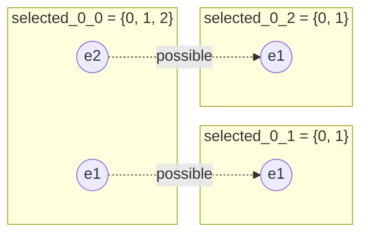
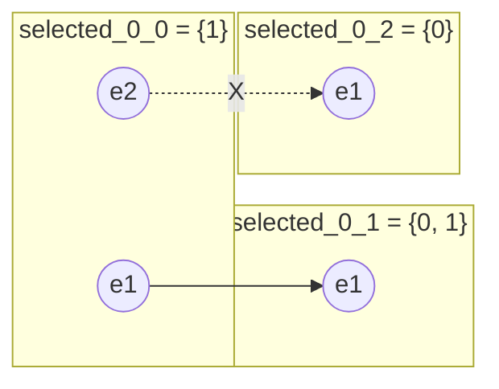
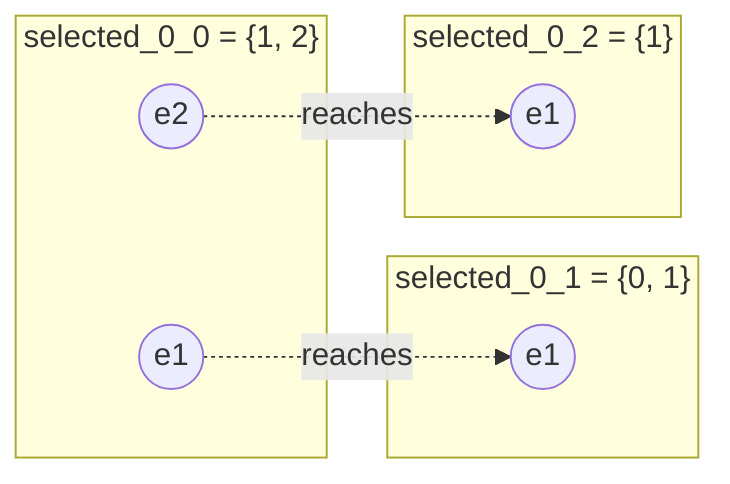
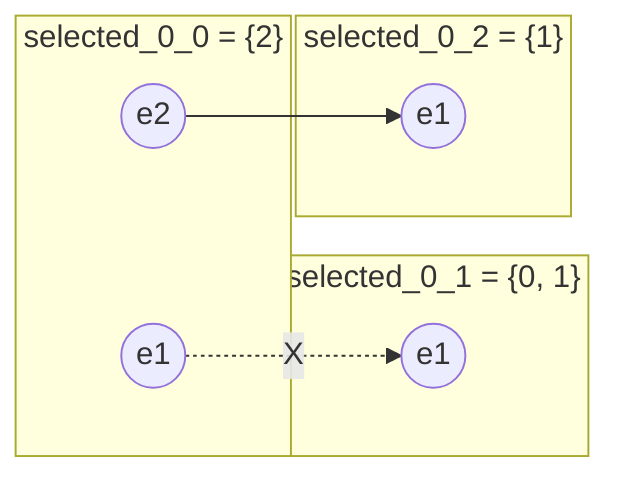
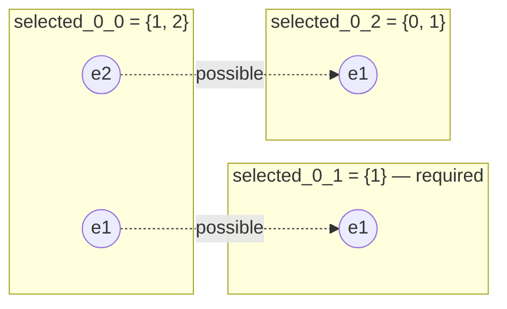
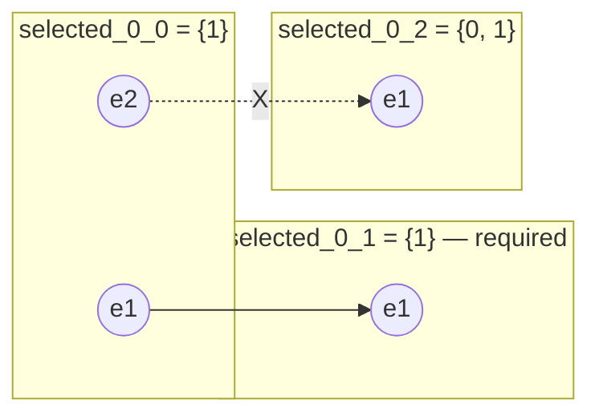
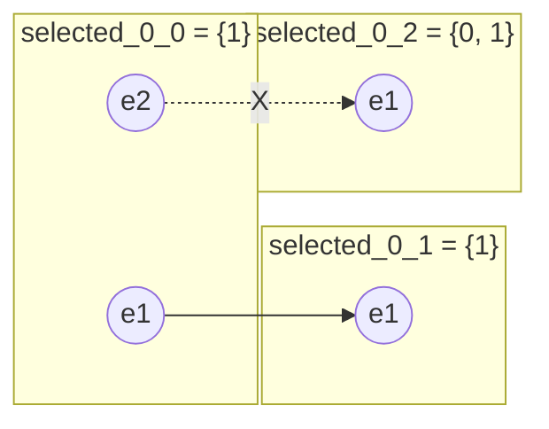
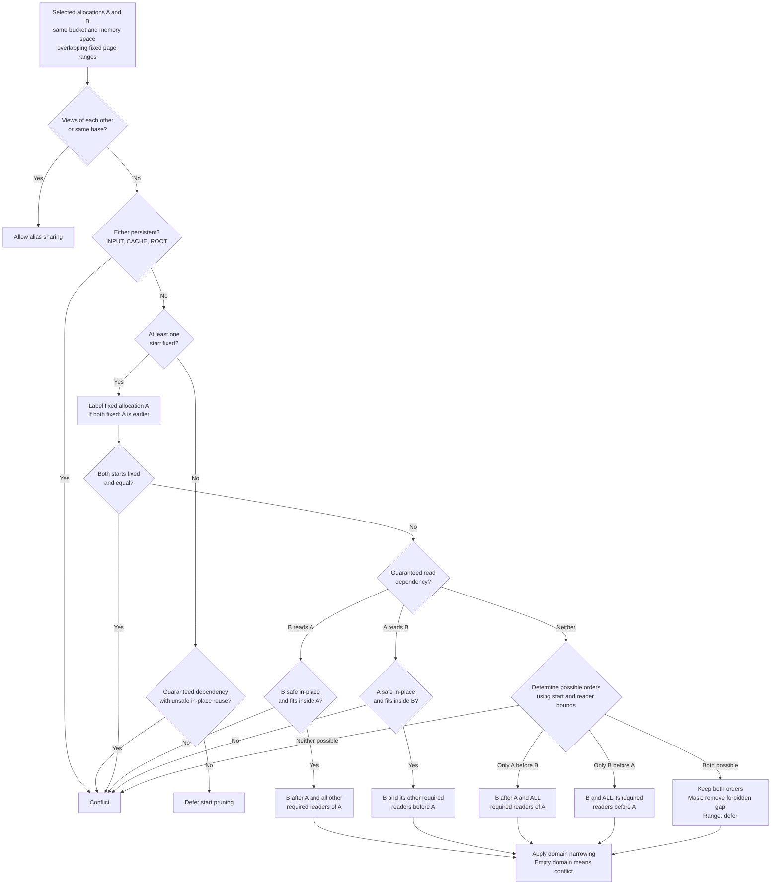
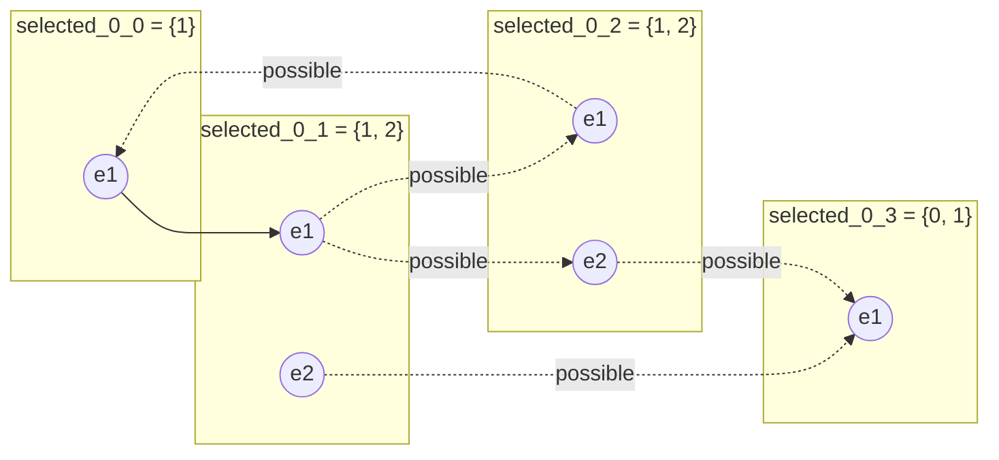
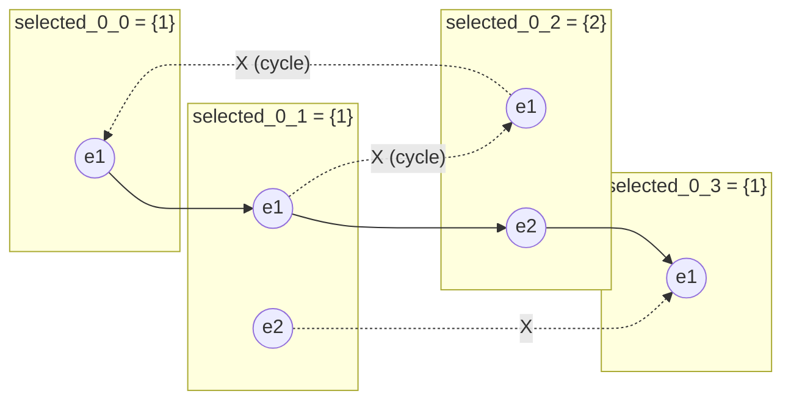

# Plan propagators

This page is the reference for the plan search propagators. The comments above each propagator class in `tensor_graphs_cpp/core/plan/propagators/` point here. A propagator narrows variable domains or reports a conflict when the current domains cannot describe a valid plan.

## Search Variable Types

Plan search operates on four types of variables (`VarType` in `tensor_graphs_cpp/core/plan/search_state.hpp`):

- **`CACHED`**: `cached_<base_e-class_id>` Binary domain `{0, 1}` indicating whether a candidate base e-class is cached across buckets (`0` = not cached, `1` = cached).
- **`SELECTED`**: `selected_<bucket_id>_<e-class_id>` Selection domain `{0, 1, ..., N}` for an e-class within a bucket, where `0` means unselected, and `1, ..., N` corresponds to selecting candidate e-node `e1, ..., eN`.
- **`START`**: `start_<bucket_id>_<e-class_id>` Integer range `[0, max_steps]` representing the dispatch step of an e-class in that bucket.
- **`OFFSET`**: `offset_<bucket_id>_<e-class_id>` Page offset range `[min_page, max_page]` representing the memory buffer allocation for an e-class in that bucket.

## Correctness

### `SelectionReachabilityPropagator`

When a selection variable changes, it may make some e-classes unreachable. Fix unreachable e-classes to `{0}`.

- **Cyclic Mode (`is_dag = false`, default):** Uses a backtrackable decremental Even-Shiloach algorithm (level labels and incoming edge pointers) to maintain single-source reachability under edge deactivations and handle cyclic components.
- **DAG Mode (`is_dag = true`):** When cycle reduction eliminates all cycles across buckets, the graph is a DAG. In DAG mode, reachability is maintained with lightweight indegree counters: deactivating an enode edge decrements the child's indegree counter. If a child's indegree reaches 0 (and it is not the root), the child is immediately unreachable, queued, and its outgoing edges are deactivated to propagate reachability loss down the DAG. On backtrack, reactivated edges increment target indegrees. Additionally, when a required e-class ($0 \notin \text{domain}$) has only one remaining active incoming parent edge/candidate, the propagator forces the parent to select that candidate to preserve reachability.

#### Example

Before selection in bucket 0, either e-node in `EClass 0` could be chosen, so both child connections are possible:

After `selected_0_0` is fixed to `1` (selecting `e1`), `EClass 2` has no connection from the selected graph and its selection is fixed to `{0}`:

### `RequiredReachabilityPropagator`

When an e-class is required ($0 \notin \text{domain}(\text{selected}_C)$), prune candidate root e-nodes that cannot reach that e-class from the root's selection domain.

- **Trigger:** Runs whenever a selection variable domain loses `0` (indicating that the e-class must be executed in that bucket), as well as during initial search propagation.
- **Index:** Statically precomputes the set of transitively reachable e-classes from each candidate e-node of the bucket root e-class (`reachable_from_root_enode_[b][en_idx]`) via BFS traversal through candidate e-nodes and child e-classes.
- **Pruning:** For any required e-class $C$, if candidate root e-node $e$ cannot reach $C$ under any downstream candidate choices, remove $e$ from $\text{selected}_{\text{root}}$'s domain. If $\text{selected}_{\text{root}}$ becomes empty, report conflict.

#### Example

Before root selection in bucket 0, either e-node in root `EClass 0` could be chosen. Candidate `e1` reaches `EClass 1`, while candidate `e2` reaches `EClass 2`:

Because `EClass 2` is required (`selected_0_2 = {1}`, with `0` not in domain), selecting candidate `e1` would leave `EClass 2` unreachable. `RequiredReachabilityPropagator` immediately prunes `1` from `selected_0_0`, fixing the root selection to `{2}`:

### `SelectionParentSupportPropagator`

A required class with exactly one remaining incoming parent-and-alternative
support forces that parent to select the supporting alternative. Duplicate edges
from the same alternative count as one support; different alternatives count as
separate supports.

Register immediately after `SelectionReachabilityPropagator`. It consumes
incremental proposals from the shared reachability graph, without another graph
scan. Proposals are temporary; domain changes use the normal trail and worklist.
The existing support notifications cover DAG edge removals and classes becoming
required. This is a sufficient single-support rule, not full reverse reachability
propagation for cyclic graphs.

#### Example

`EClass 1` is required (`0` is absent from its domain). Only root alternative
`e1` connects to it, so choosing root alternative `e2` would disconnect a required
class. Parent support forces `selected_0_0 = {1}` before the search branches.

**Before parent support**

**After parent support**

Both diagrams retain every e-class and alternative. The solid arrow is the forced
support; `X` marks the disabled alternative. `EClass 2` remains `{0, 1}` here:
fixing it to `{0}` is a subsequent deduction by `SelectionReachabilityPropagator`.

If both `e1` and `e2` connect to the required child, neither alternative is
forced by this rule. Repeating the child twice within `e1` still counts as only
one supporting alternative.

Tests are separate from the BFS domain-equivalence oracle for reachability:
`testParentSupport` exercises forcing, duplicate edges, multiple alternatives,
removing a support, rollback, and sibling propagation.

### `SelectionChildrenPropagator`

When an e-class is fixed to a selected e-node, every child e-class of that e-node must be selected. Remove `0` from each child's selection domain. An invalid selected e-node index is a conflict.

#### Example

Before selection in bucket 0, `EClass 1` and `EClass 2` could still be unselected (`0` in domain):

After `selected_0_0` is fixed to `1` (selecting `e1`), child `EClass 1` must be selected, so `0` is removed from its domain (`selected_0_1 = {1}`). Meanwhile, unreached `EClass 2` retains `{0, 1}` under this propagator alone:

### `UnselectedStartOffsetPropagator`

When an e-class is fixed to `{0}` (unselected), fix all its start & offset variables to `0`. These values are irrelevant for an unselected e-class.

### `CacheExclusionPropagator`

When a base e-class is fixed as not cached `{0}`, remove e-node choices selection domains of corresponding e-classes in every bucket where the e-node is any of:
-`CACHE`
-`SCATTER`
-`FUSED` with `CACHE` or `SCATTER` as root of refFactory graph

`CACHE`/`SCATTER` e-nodes can only be used when that base e-class is cached.

### `InputPruneStartPrecedencePropagator`

On start or selection changes, revisit the changed class and its consumers.
Starts need not be fixed. Remove an alternative when one of its inputs has a
minimum start greater than or equal to the consumer's maximum. For every input
shared by all remaining alternatives of a mandatory consumer, enforce
`input.max <= consumer.max - 1`. Report the actual consumer, input, alternative,
and bounds on contradiction.

### `ConsumerStartPrecedencePropagator`

On start lower-bound or selection changes of a mandatory class, propagate its
minimum plus one to consumers that require it in every remaining alternative.
Remove dependent alternatives whose consumer maximum cannot support that bound.
The legacy `fixed_starts_only` constructor argument is retained for source
compatibility but no longer weakens propagation. Existing view traversal is
restricted to classes whose remaining alternatives all depend on the traversed
producer, so a bypass alternative cannot impose an unconditional bound. Conflicts include the source, traversed class, actual consumer,
selection domain, and required minimum.

### `StartPrecedencePropagator`

On selection or start changes, compute each remaining alternative's earliest
start as the maximum of its inputs' minima plus one. Raise a mandatory class's
minimum to the minimum of these alternative bounds. Revisit consumers on child
changes. Selection changes also enqueue starts on affected input edges so both
forward and backward propagation reach closure without waiting for assignment.

### `StartUniquePropagator`

When a selected e-class's start is fixed, remove that start value from the start domains of other e-classes whose start is not fixed to {0}. This prevents two active operations from occupying the same execution step. Because we cannot represent holes in the start domain when it is a range, only remove if value is equal to min/max (maybe keep a hashmap for fast lookup of values based on min/max). But also, I want domains to be able to switch between mask and range so for example if we manage to narrow down start to a range < 32 we can swap it to a mask and then we can remove in the middle.

### `StartBoundsPropagator`

Enforce all-different bounds consistency for mandatory start variables within
each bucket. Optional classes are excluded until their selection excludes zero.
At propagation quiescence, first check fixed-start collisions and remove occupied
fixed slots from the rank coordinate system. Sweep only the remaining domains in
ascending maximum order, then repeat with negated bounds to tighten maxima.
Removing fixed slots from the coordinates preserves interval capacity while
avoiding repeated singleton Hall reservations for every assigned operation.
If the interval hulls of n remaining variables share at least n available ranks,
every bound has interval support, so the sweeps can be skipped safely. A segment tree counts variables contained
in intervals and tracks saturated Hall reservations. An interval `[a,b]` cannot
contain more than `b-a+1` mandatory domains. If exactly that many domains are
contained, other variables cannot use its slots at their bounds. Interior holes
are not removed; this is bounds consistency, not domain consistency for masks.
Changes re-enter the propagation queue until closure. All scratch state is rebuilt
from current domains, making backtracking independent of cached reservations.
Conflicts report overload capacity/count and up to eight witnesses, fixed-start
collisions, or the start whose bounds are covered by occupied slots/Hall
reservations. `available-rank-interval` uses the compressed coordinates, so its
capacity counts available slots; witness domains remain in original start ranks.

### `MemoryNoOverlapPropagator`

This combines two paths: `FixedOffsetStartPropagator` validates memory reuse and
narrows start domains; `WriteAfterReadPropagator` also checks offset placement and
narrows the changed offset domain against indexed fixed allocations when sharing
is unsafe. Both paths run on initialization, offset changes, and cache changes.
Start changes run only the first path, and only when that allocation's offset is
fixed. Cache changes rebuild the affected bucket information.

The flowchart below describes the **fixed-offset start path**. Allocation pairs
must be in the same bucket and memory space, with selected operations and fixed
offsets whose physical page ranges overlap:

$$\max(offset_A, offset_B) < \min(offset_A + size_A, offset_B + size_B)$$

1. **View aliases:** Allow sharing when the allocations are views of each other
   or have the same base e-class.
2. **Persistent buffers:** Otherwise, overlapping `INPUT`, `CACHE`, or `ROOT`
   buffers conflict, regardless of start assignments.
3. **Neither start fixed:** Reject a guaranteed producer-consumer dependency
   if in-place reuse is unsafe. Otherwise defer start pruning until at least one
   start is fixed; this path does not choose an order using two unfixed starts.
4. **At least one start fixed:** Label a fixed allocation $A$. If both starts
   are fixed, label the earlier allocation $A$; equal starts conflict.
   - **$B$ reads $A$:** Require a kernel-declared safe in-place input and require
     $B$'s footprint to fit inside $A$'s buffer. Set
     $start_{min}(B) \ge \max(start(A), \max_{C\in R(A)\setminus\{B\}}start_{min}(C)) + 1$.
     Narrow each other required reader's upper bound to $start_{max}(B)-1$.
   - **$A$ reads $B$:** Apply the symmetric safety and containment checks.
     Set $start_{max}(B) \le start(A)-1$, and every other required reader of
     $B$ must also have $start_{max}(C) \le start(A)-1$.
   - **Neither reads the other:** Test the two possible reuse orders. For
     $A$ before $B$, let
     $t_{after A}=\max(start(A),\max_{C\in R(A)}start_{min}(C))+1$.
     This order is impossible if $start_{max}(B)<t_{after A}$.
     $B$ before $A$ is impossible if $start_{min}(B)\ge start(A)$, or a required
     reader of $B$ cannot execute before $A$ (including the minimum one-step
     producer-to-reader separation).
     - **Only $A$ before $B$ possible:** Raise $start_{min}(B)$ to $t_{after A}$
       and cap each required reader of $A$ at $start_{max}(B)-1$.
     - **Only $B$ before $A$ possible:** Cap $start_{max}(B)$ and each required
       reader of $B$ at $start(A)-1$.
     - **Both possible:** Keep both orders. For a mask domain, remove forbidden
       $B$ start values in $[start(A),t_{after A})$ within the implementation's
       $[0,31]$ removal window. A range domain is left unchanged because it
       cannot represent that interior gap.
     - **Neither possible:** Report conflict.

Here $R(X)$ includes only required readers: their selection excludes `0`, and
all remaining active alternatives read $X$. An optional reader or an alternative
that might avoid reading $X$ does not justify unconditional reader-bound pruning.
Starts are dispatch positions; strict inequalities model the ordering needed to
finish a read before overwriting the buffer. Any narrowing that empties a domain
is a conflict. Fixed starts are validated by these same checks.

### `ViewSelectOffsetPropagator`

When an e-class $V$ is fixed to a selected view e-node whose base is $B$:
- Intersect the offset domain of $V$ with the offset domain of $B$:
  $$\text{common\_min} = \max(\min(offset_V), \min(offset_B)), \quad \text{common\_max} = \min(\max(offset_V), \max(offset_B))$$
- If $\text{common\_min} > \text{common\_max}$, report conflict (disjoint allocation).
- Narrow both $offset_V$ and $offset_B$ to $[\text{common\_min}, \text{common\_max}]$. Any narrowing of $offset_B$ queues offset updates to all other aliases via the solver worklist.

### `ViewToBaseOffsetPropagator`

When the offset domain of view e-class $V$ narrows:
- **Confirmed view:** If $V$ is fixed to a view of base $B$, narrow $offset_B$ to $[\max(\min(offset_B), \min(offset_V)), \min(\max(offset_B), \max(offset_V))]$. Disjoint ranges report a conflict.
- **Unconfirmed candidate view:** For each candidate view e-node in $V$ with candidate base $B$, if $offset_V$ and $offset_B$ have disjoint domains, remove that e-node from $selected_V$'s domain. If $selected_V$ becomes empty, report conflict.

### `BaseToViewOffsetPropagator`

When the offset domain of base e-class $B$ narrows:
- **Confirmed views:** For every confirmed view $V$ of $B$, narrow $offset_V$ to $[\max(\min(offset_V), \min(offset_B)), \min(\max(offset_V), \max(offset_B))]$. Disjoint ranges report a conflict.
- **Unconfirmed candidate views:** For every candidate view consumer $V$ of $B$, if $offset_V$ and $offset_B$ have disjoint domains, remove the view e-node pointing to $B$ from $selected_V$'s domain. If $selected_V$ becomes empty, report conflict.

### `PearceKellyCyclePropagator`

When a selection is fixed to a nonzero e-node, check the dependency graph formed by the other fixed nonzero selections for a cycle. Reject a selection that closes a cycle.

### `CycleAvoidancePropagator`

Proactively prunes candidate e-nodes from selection domains across the E-graph that would close a directed cycle with currently fixed selections.

While `PearceKellyCyclePropagator` acts reactively (detecting a cycle only after a cyclic selection is branched on, causing hyperbox pruning during search diving), `CycleAvoidancePropagator` removes cyclic candidate e-nodes before branching can explore them.

#### Invariant and Mechanism

In a valid execution plan, the directed graph formed by selected e-nodes and their children must be a Directed Acyclic Graph (DAG). Let $G_{\text{fixed}}$ be the directed dependency graph formed by all currently fixed nonzero selections in bucket $b$, where a fixed selection in e-class $P$ pointing to child e-class $C$ defines a directed edge $P \to C$.

- **Acyclic Selection Invariant:** If there is a directed path from e-class $U$ to e-class $V$ in $G_{\text{fixed}}$ ($U \leadsto V$), then $V$ (or any descendant of $V$) cannot select an e-node that has $U$ (or any ancestor of $U$) as a child. Choosing such an e-node would introduce a back-edge and close a directed cycle:
  $$U \leadsto V \to \dots \to U$$

#### Incremental Propagation Algorithm

1. **Trigger:** Runs whenever a selection variable `selected_<bucket_id>_<e-class_id>` becomes fixed to a nonzero candidate $e^*$ ($e^* \ge 1$).
2. **Path Reachability:**
   - Fixing $P \mapsto e^*$ adds directed edges $P \to C_i$ for each child $C_i \in \text{children}(e^*)$.
   - Compute the ancestors of $P$ in $G_{\text{fixed}}$: $\text{Anc}(P) = \{ A \mid A \leadsto P \}$.
   - For each child $C_i$, compute its descendants in $G_{\text{fixed}}$: $\text{Desc}(C_i) = \{ D \mid C_i \leadsto D \}$.
   - Every ancestor $A \in \text{Anc}(P)$ now reaches every descendant $D \in \text{Desc}(C_i)$ via $A \leadsto P \to C_i \leadsto D$.
3. **Domain Pruning:**
   - For each descendant $D \in \text{Desc}(C_i)$ whose selection variable is not yet fixed:
     - For each candidate e-node $e_D \in \text{selected}_D$:
     - If $\text{children}(e_D) \cap \text{Anc}(P) \neq \emptyset$, candidate $e_D$ would close a cycle. Remove $e_D$ from $\text{selected}_D$'s domain:
       $$\text{selected}_D \leftarrow \text{selected}_D \setminus \{e_D\}$$
   - If any selection domain becomes empty, report conflict.
   - Queue any narrowed selection variables to the solver worklist to immediately trigger subsequent propagations (such as reachability, children, and start precedence).

#### Example

Consider four e-classes in bucket 0:
- `EClass 0` is fixed to `1` (selecting `e1`, which requires child `EClass 1`).
- `EClass 1` has domain `{1, 2}`: `e1` requires child `EClass 2` (realized by candidate `e1` or `e2`); `e2` requires child `EClass 3`.
- `EClass 2` has domain `{1, 2}`: `e1` requires child `EClass 0`; `e2` requires child `EClass 3`.
- `EClass 3` is a terminal leaf operation.

Before `selected_0_1` is fixed, both choices in `EClass 1` and `EClass 2` are possible:

When search fixes `selected_0_1 = {1}` (selecting `e1`, which requires child `EClass 2`):
- `EClass 0` $\in \text{Anc}(\text{EClass 1})$ and `EClass 2` $\in \text{Desc}(\text{EClass 2})$.
- Candidate `e1` in `EClass 2` has child `EClass 0`, which would close the cycle `0 -> 1 -> 2 -> 0`.
- **Under `PearceKellyCyclePropagator` alone:** `selected_0_2` remains `{1, 2}`. Later, search branches on `selected_0_2 = {1}`, dives into the left hyperbox, detects the cycle, and prunes the node.
- **Under `CycleAvoidancePropagator`:** As soon as `selected_0_1` is fixed, the propagator discovers that candidate `e1` in `EClass 2` consumes ancestor `EClass 0` and removes `1` from `selected_0_2`. Combined with `SelectionChildrenPropagator` removing `0` from required children, `selected_0_2` is immediately fixed to `{2}` without branching!

### `ParentRemovalPropagator`

When an e-class is fixed unselected, remove every parent e-node that requires it from the parent's selection domain. This is the contrapositive of `SelectionChildrenPropagator`.

### `CacheRequirementPropagator`

When a selected e-node is `CACHE` or `SCATTER`, require its corresponding base e-class to be cached. In the reference-factory graph, a fused e-node with a `SCATTER` root also requires caching.

### `CachedOffsetAllocationPropagator`

When a cache variable is fixed to `1`, assign its offset variables the same stable arena range in every bucket. Respect preallocated pages, offset-domain bounds, memory-space capacity, and the ranges already assigned to other active caches. If any corresponding offset is already fixed, synchronize the rest to that offset; otherwise append the allocation after the existing active cached ranges.

## Search pruning and allocation

### `CriticalPathPropagator`

After selection changes, recompute the per-bucket critical path bottom-up as the selected operation cost plus the maximum child critical path. Raise the bucket lower bound to at least this value and reject the state when the lower bound exceeds the incumbent. Only initialize after we have an incumbent.

### `CacheBudgetPropagator`

Sum of sizes of cached vars in a given mem space must be less than that space's memory cap. On cache selection, check sum < cap.

### `EarlyCacheBudgetPropagator`

Sum of sizes of cached vars in a given mem space must be less than that space's memory cap. On cache selection, for any unfixed cache vars if size > (cap - sum) then remove 1 from that var's domain.

### `EngineWorkloadPropagator`

Maintain selected work per execution engine and bucket. Raise each bucket's lower bound to at least its largest engine workload, and reject the state if that lower bound exceeds the incumbent.

### `CachedOffsetPropagator`

For a base e-class fixed as cached, all corresponding offset variables across buckets must use the same page offset. A fixed offset is copied to the other buckets; conflicting fixed or restricted domains are a conflict. When caching is required, reuse any already fixed corresponding offset.

### `WriteAfterReadStartPropagator`

When a selected start variable becomes fixed, inspect active allocations with overlapping fixed offsets whose start domains already establish an order. If the later allocation does not read the earlier one, raise its minimum start to after the earliest last reader of the earlier allocation. This performs the reader ordering before branching on individual starts.

### Search diagnostics and timing

Profile builds measure every propagator call directly. `total` includes
initialization; initialization and internal phase timers are subsets, not extra
costs. Dispatcher overhead excludes measured propagator bodies and includes queue
coalescing. Maxima are measured over all calls, rather than sampled calls.
Per-propagator counters report domain changes, calls with no domain changes,
start minimum/maximum tightenings, and removed selection values. Counters count
work performed across branches and are intentionally not undone on restoration.

Conflict details are logged for the first three occurrences and every thousandth
occurrence thereafter. Actual pending work and deferred batches are reported
separately. Up to 256 concrete conflict signatures are retained; every 10,000
iterations the five most frequent retained signatures and untracked occurrence
count are emitted. This bounded diagnostic is not conflict learning.

After successful root propagation and at those propagated branch points, the schedule audit reports mandatory/fixed
start counts, the current horizon/capacity, and forward/backward precedence gaps
computed independently from remaining alternatives. A nonzero gap is evidence
that a wakeup or propagation rule is missing. This audit does not run inside an
unfinished conflicting propagation call.

Write-after-read profiling separates allocation gathering, reader-index lookup/building,
and overlap processing. `reader-rebuilds` counts actual index builds;
`reader-cache-hits` counts calls reusing an existing index, and `reader-index-skips`
counts scans needing no reader index. Candidate and ordered overlap pair counts
show how much scan work leads to an established ordering. The generic domain-change
counters show whether that work tightens any start bounds.

### Write-after-read reader caching

The start propagator caches every selected value's readers, including aliases
through selected view chains, per bucket and selection revision. Selection changes
and restoration both advance the revision, invalidating the cached relationships.
Only build or retrieve the index after finding the first eligible overlapping pair
whose start bounds establish an order. Calls with no such pairs build no index.
Reader start minima are read from the live domains on every call, so start-only
changes reuse relationships without retaining stale bounds. Reusing a propagator
on a different search state clears the indexes. Graph structure stays immutable
during a search, as required by the other planner indexes.

### Future incremental allocation processing

Allocation overlap has different invalidation requirements: selected alternatives
change shapes/view status, offsets change physical intervals, and cache status
changes persistence. A reader cache keyed only by selection revision must not be
used as an allocation cache. Index allocations by memory space and physical
interval, with reverse links from readers to the values they read.

When a start changes, reconsider pairs involving that allocation and pairs whose
earlier value is read by the changed operation. Changes to either endpoint can
establish ordering; reader lower-bound changes can raise the required overwrite
rank. Enqueue newly changed starts until closure. Selection, offset, and cache
changes must invalidate the relevant indexes; restoration must rebuild or restore
them as well. Keep a full-scan reference implementation for randomized equivalence
checks, especially view aliases, persistence, and branch restoration.

Reader construction now happens at most once per needed selection revision.
Incremental allocation processing would additionally replace repeated whole-bucket
overlap scanning with pair processing driven by affected allocations/readers. Dense overlaps can still require many pairs. The new phase
and effectiveness counters should establish the likely gain before implementing
this additional stateful optimization.
