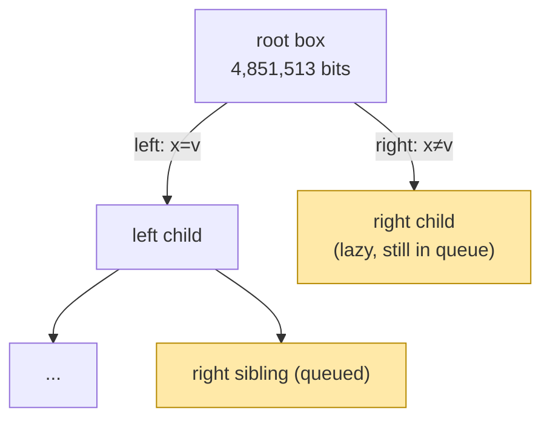
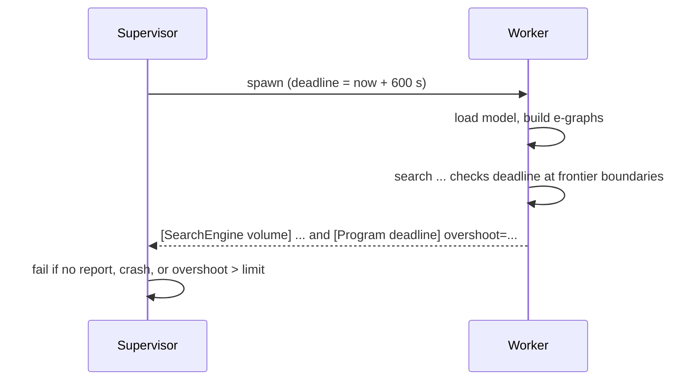
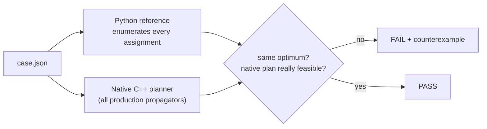
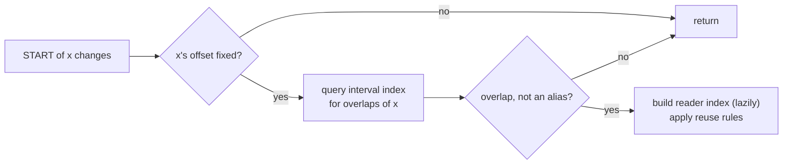
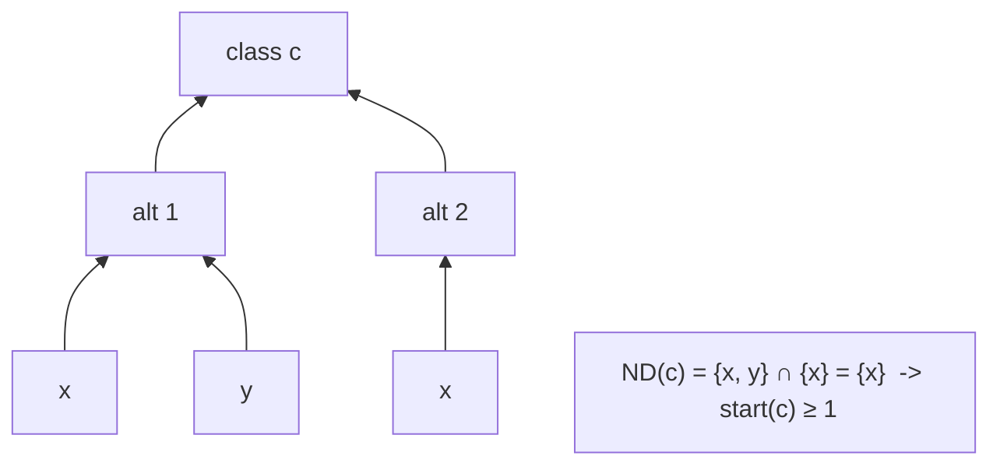
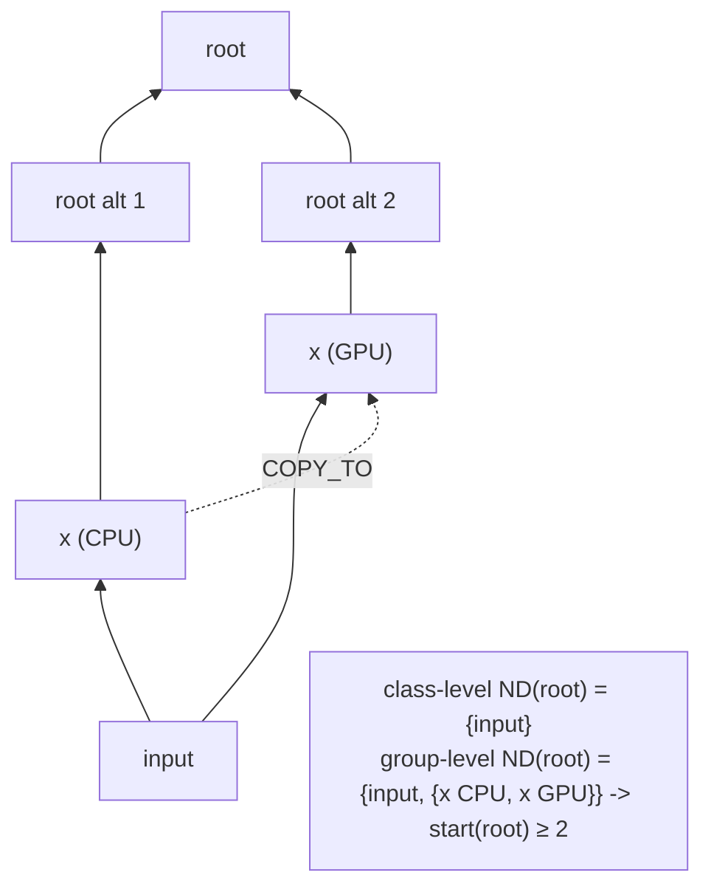
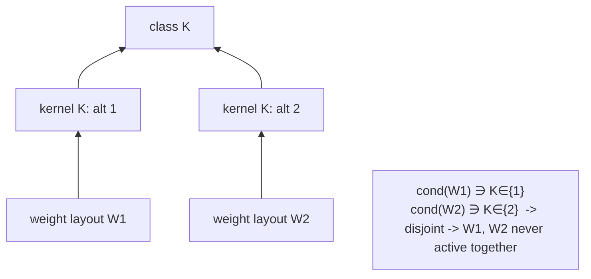
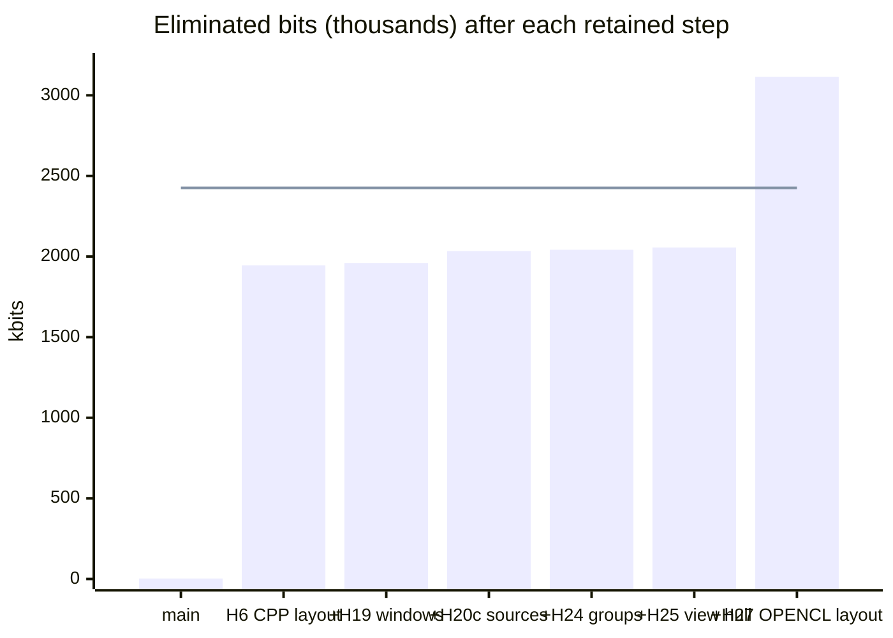
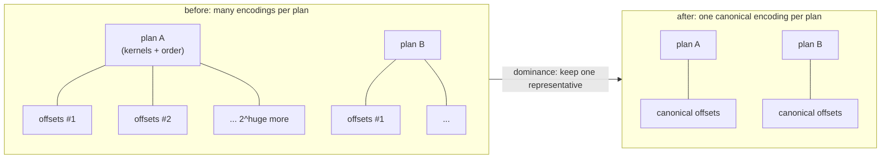
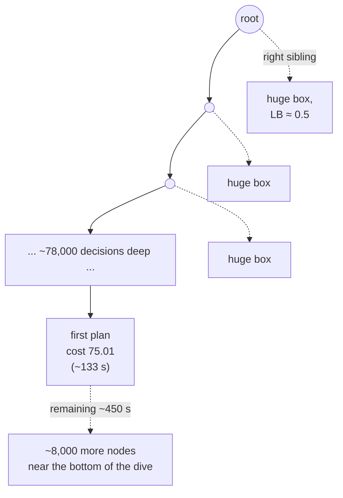

# Walkthrough: the `faster-search` branch

This document walks through every change the `faster-search` branch makes on top of `main` (merge base `e31b487b`), in the order they were built. For each one it covers what problem it solves, how it works (with a picture), and why it is safe. The final section explains why the search has eliminated over half of its search-space bits yet still has not found a plan better than its first incumbent.

The branch has two commits:

| Commit | Theme |
|---|---|
| `d6397868` "improve search" | **Measurement**: a way to score the search (bits), a hard time budget, and an exhaustive correctness oracle. |
| `20bda2dd` "improve search" | **Optimizations**: memory layout dominance, start-rank windows, propagator speedups, regression tests. |

Headline result on `tests.test_gemma_output --config decode --optimal --timeout 600`:

| | Original `main` | Branch head |
|---|---:|---:|
| Eliminated bits (of 4,851,513) | 2,690 | **3,114,376** (64%) |
| Time to first incumbent | 230.2 s | **~133 s** |
| First / final plan cost | 75.0097 / 75.009705 | 75.0097 / 75.009705 (unchanged) |

---

## 0. Background: what the planner searches over

Each **bucket** (16 decode positions plus one zero-weight "full" bucket) has an e-graph with about 7,559 **e-classes**: tensors that must or might be computed. Each class has one or more **alternatives** (e-nodes): different kernels, devices or fusions that compute it. The planner chooses four kinds of variables:

```mermaid
flowchart LR
    subgraph Per base, shared by all buckets
      C["CACHED&lt;base&gt;<br/>{0,1}<br/>keep a copy across buckets?"]
    end
    subgraph Per bucket, per e-class
      S["SELECTED<br/>{0 = unused, 1..n = alternative}"]
      T["START<br/>dispatch rank 0..N-1"]
      O["OFFSET<br/>page address in its memory space"]
    end
    S -- "which kernel, which children" --> T
    T -- "order => lifetimes" --> O
```

- **Cost** only depends on SELECTED and the *order* of START (the simulator replays the dispatch order on the CPU and GPU engines).
- **OFFSET** never affects cost. It only has to be *feasible*: buffers that are live together must not overlap.

The search is a branch-and-bound over a **hyperbox**: every variable has a domain (range or small bitmask). A branch splits one variable's domain into two disjoint parts.

---

## Commit 1: measurement infrastructure

### 1. Search-volume metric (`search_volume.hpp`, `selector.hpp`, `search_node.hpp`)

**Problem.** There was no number that says "how much of the search space is left". Iteration counts and wall time don't measure progress toward exhausting the search.

**What it does.** Every open node of the search tree is a box. The engine sums the volumes of all open boxes and compares that sum to the initial box:

```
box_bits(H)        = Σ_i log2 |D_i|              (one box)
remaining_bits     = log2( Σ_boxes 2^box_bits )  (all open boxes)
eliminated_bits    = total_bits − remaining_bits
```



The yellow boxes are the frontier. Remaining volume is the log of the sum of their sizes. Boxes whose stored lower bound is at least the incumbent cost are dropped, since they can't contain a better plan.

`DomainVolumeTracker` keeps per-variable `log2|D|` in a sum tree, so each domain change costs O(log n). Selectors expose `appendRemainingBoxBits`, and branch children are checked to be disjoint subsets of their parent, so the sum never double counts.

**Why it's valid.** Disjoint boxes make the sum equal to the union volume. The metric counts *encoded assignments*, not distinct plans, which matters a lot in the final section.

### 2. A hard, honest time budget (`tests/test_gemma_output.py`, `search_engine.hpp`)

`--timeout 600` launches a **worker** process with `TG_PROGRAM_DEADLINE` (a wall-clock timestamp) and `TG_SEARCH_VOLUME=1`. The **supervisor** kills the worker at budget + 2 s and fails the run if there is no volume report or the deadline overshoot is too large. The budget includes Python startup, model loading and preprocessing, so speedups anywhere count.



The second commit also logs a precise `event-epoch` at each new incumbent. Time to first incumbent is then measured from program start (`epoch − deadline + 600`), and the overshoot limit was relaxed from 50 ms to 1 s.

### 3. The planner oracle (`bindings/planner_oracle.hpp`, `tests/planner_oracle_reference.py`, `tests/test_planner_oracle*.py`, cases 01–14)

**Problem.** Pruning rules can silently delete the optimum. Gemma is far too large to check exhaustively.

**What it does.** Tiny JSON cases (≤ 6 classes, ≤ 4 buckets) are solved twice:



Every new pruning rule on this branch came with adversarial cases (15–28) designed to break it. The oracle is empirical evidence, not a proof, so each rule also has a written soundness argument (repeated below).

### 4. Views occupy no engine (`engine_workload.hpp`)

The simulator gives views zero duration and no engine, but `EngineWorkloadPropagator` charged their nominal cost to an engine. That could overstate a lower bound and wrongly prune. It now skips views, matching the simulator.

---

## Commit 2: optimizations

The changes are grouped by the problem they attack. The `H#` labels match `docs/agents/SEARCH_IMPROVEMENTS.md`.

### 5. Static private memory layout for CPP (H6, with repairs H8 and H17): `static_private_layout.hpp`

**Problem.** Every CPP offset spanned about 28.9 bits (`[0, capacity − size]`), and offsets were 62% of all bits. Yet offsets don't change cost.

**Idea (dominance).** If *every* allocation of a memory space can get its own page range at the same time, then any feasible plan can be moved to that layout without changing selections, order, or cost. All overlap-related constraints become vacuous. So we can fix every offset at the root and still keep an optimal plan.

```
CPP address space (31.5 GB, 64-byte pages)

 0        prealloc        cache slots (shared by all buckets)        per-bucket private slots
 |==========|=================================|==========================================|.....free.....|
  inputs/     base A | base B | base C | ...     class 1 | class 2 | class 3 | ...  (bucket b)
  weights                                        buckets REUSE this range (pairs are only
                                                 compared within one bucket)
```

**Why it's sound.** Take any feasible plan and move each allocation to its slot. Distinct allocations no longer overlap, so no-overlap, reuse-after-read and write-after-read constraints all hold. A view keeps its base's address, and cached copies keep the shared base slot. Selections and starts are untouched, so the cost is identical. The rule only fires if the whole layout fits the capacity and every slot is inside its variable's current domain.

Two correctness repairs were found by adversarial tests:
- **H8 (nested views):** a view may alias *several* possible bases through nested view alternatives. The rule now collects the full union of possible base addresses and checks each one. Oracle case 19 broke the first version.
- **H17 (padded alternatives):** different alternatives of a class can have different storage spans (strides/padding). Slots now reserve the *maximum* footprint over alternatives. The native test `private_layout_regression.hpp` reproduced the bug first.

Effect: the 67,302 CPP offsets are fixed and **+1.94M bits** are eliminated.

### 6. Canonical values for unused classes (`unselected_start_offset.hpp`)

When a class becomes unselected, its start and offset are irrelevant, and the propagator pins them to a canonical value. It used to blindly write `0`, which could *widen* a domain that another rule had already narrowed (illegal for the box metric). Now:

```
fixed already?  -> leave it
0 in domain?    -> 0     (offsets: preallocation end if in domain)
otherwise       -> domain minimum
```

### 7. Making memory propagation fast (H7, H9, H11): `memory_no_overlap.hpp`, `write_after_read_start.hpp`

**Problem.** With H6, all 67k CPP allocations had fixed offsets, so the memory propagators did pairwise scans over huge sets. The first dive slowed from about 230 s to beyond the budget (no incumbent at all).

- **H7 (interval queries):** quadratic "every fixed allocation vs every other" scans were replaced by an address sweep (sort by offset; only later allocations starting before the current one ends can overlap), plus interval-tree queries for incremental checks.
- **H9 (cache by allocation revision):** a counter bumps on SELECTED/OFFSET/CACHED changes and on undo. The write-after-read start propagator caches its overlapping-pair list per revision and re-reads only live START domains. Start-only changes reuse the pairs.
- **H11 (lazy reader metadata):** reader indexes are built only when a genuinely overlapping, non-alias pair is found. View/base alias pairs are accepted immediately.



These are pure speedups: the same constraints with the same results. Time to first incumbent dropped back to about 201 s (from 302 s right after H6).

### 8. Start-rank windows (H19, H20c, H24): new `start_rank_window.hpp`

START is a dispatch **rank** in `[0, N−1]` and held about 1.6M bits. Three ideas narrow it, all applied once at the root.

**(a) Necessary predecessors give a lower bound (H19).** If every way of computing `c` requires class `d` to run first, then `d` is a *necessary descendant* of `c`. Active starts are distinct, so `start(c) ≥ |ND(c)|`.

```
ND(c) = ⋂ over c's alternatives a  ( ⋃ over children ch of a  ({ch} ∪ ND(ch)) )
```



**(b) Rank compression gives an upper bound (H19).** Cost and every constraint depend only on the *relative* order of active starts. So any plan can be renumbered to 0..k−1 without changing anything (k ≤ N active classes). In that canonical form, `start(c) ≤ N − 1 − |NA(c)|`, where `NA(c)` = classes that must come *after* `c`: the intersection over possible parents `p` of `{p} ∪ NA(p)`. Renumbering only lowers values, so it stays in-domain if every start domain was *downward closed* from 0 at solve entry. That is recorded per bucket by `recordStartDomainShapeAtEntry()`; oracle case 24 has sparse domains where this must not fire.

```
original ranks:   a=3   b=9   c=12   d=40          (k = 4 active)
compressed:       a=0   b=1   c=2    d=3     same order -> same cost, same constraints
```

**(c) Persistent sources first (H20c).** INPUT/CACHE ops, and non-writing views of them, have zero runtime and persistent storage. Moving them before everything else changes neither cost nor any temporary buffer's lifetime. So sources get fixed ranks `0..S−1`, and every other class gets `start ≥ S + |ND \ sources|`.

```
rank:  0 1 2 ... S-1 | S  S+1 ...                    N-1
       [  sources   ] [ everything else, dense, same relative order ]
```

**(d) Groups instead of classes (H24).** The same tensor often exists in two memory spaces (CPU and GPU copy, linked by COPY_TO). Class-level necessity breaks when a plan can use either copy. Counting *disjoint groups* fixes this: if each of several disjoint groups must have some active member before `c`, those are distinct classes. Any partition is sound, and COPY_TO-linked classes form the groups.



The native test `start_rank_window_regression.hpp` checks this exact graph. Oracle cases 25/26 cover unused classes whose window excludes 0 and fused bypasses.

Effect: about **+96k bits** in total. It is small because only the 17 bucket roots are mandatory (every other class is optional), and fused alternatives legitimately skip intermediate tensors.

### 9. Skip memory work in certified spaces (H21, H23): `memory_no_overlap.hpp`, `search_state.hpp`

Once a layout is certified (§5, §12), distinct allocations in that space can never overlap while both are active. So every memory check there is vacuous. The certified space is recorded in `SearchState::private_layout_spaces`, and:
- **H21:** START/OFFSET events for allocations in that space return immediately;
- **H23:** those allocations are left out of the fixed-offset index and out of the global rescans triggered by every CACHED change (those rescans had cost 40 s per 150 s).

These are pure speedups, worth about 20 s each on time to first incumbent.

### 10. `StartUnique` rebuilds one bucket, not seventeen (H22): `start_unique.hpp`

`StartUnique` removes a fixed rank from other active classes. It kept a cached "active classes" list for *all* buckets, keyed by a global selection revision that changes almost every iteration. So each call rebuilt 17 lists (45 s per 150 s once sources had fixed ranks). The lists are now per bucket and rebuilt only for the bucket being scanned, with identical results.

### 11. View offset hull (H25): `static_private_layout.hpp`

A view that may alias several bases can't be fixed to one address. But it *must* equal one of its candidate base addresses (already collected for H8), so its domain is narrowed to `[min address, max address]`. Effect: **+14k bits**.

### 12. Exclusivity-shared layout for OPENCL (H27): `static_private_layout.hpp`

This is the change that crossed the target (**+1.06M bits**).

**Problem.** GPU memory is 524,288 pages (2 GiB). OPENCL classes total 1,631,336 pages, mostly alternative layouts of weights, so one private slot per class doesn't fit and H6 skipped OPENCL.

**Observation (from a CP-SAT experiment).** No single plan can hold more than **467,559 OPENCL pages active at once**. Weight variants are consumed by *different alternatives of the same kernel class*, so a plan picks at most one of them.

**Certificates.** For each class `x`, the propagator computes *necessary conditions*: "if `x` is active, class `P` must pick an alternative from set `S`". These come from reachability: an active class needs an active parent alternative that uses it.

```
cond(root) = {root: any}
cond(x)    = ⋂ over supports (P, a)  ( cond(P) ∪ {P: {a}} )    keep common classes, OR their allowed sets
x, y exclusive  <=>  some class P appears in both with DISJOINT allowed sets
```



**Layout.** Place cacheable bases first (largest first, first fit), then each bucket's other OPENCL classes. A class may overlap only classes it is certified exclusive with:

```
GPU pages:  0                                                        467,784   524,288
            |==W1==|            |=====W5=====|      |==tmp a==|           |   free  |
            |==W2==|  (W1,W2 exclusive: share)       |==tmp b==|  (a,b exclusive)
            |=W3=|                                   anything that CAN be co-active
                                                     gets disjoint pages
```

Bucket 0's layout needs **467,784 pages**, within 0.05% of the 467,559-page co-activity optimum, and fits.

**Why it's sound.** Take any feasible plan. Two allocations active in the same bucket are by definition *not* exclusive, so their slots are disjoint, and every memory constraint holds just as with private slots. Cached bases keep one slot across buckets. Two cached bases may share pages only if they are exclusive in a bucket both appear in. A cached base must be selected in *every* bucket, so such a pair can never both be cached.

**Adversarial tests.**
- Case 27: two exclusive temporaries *must* share to fit, so the rule fires.
- Case 28: `a` and `b` look exclusive through the root's alternatives, but `m` reads both on another path. The cheaper plan needs both live and does not fit. A wrong certificate would overlap them and report an impossible, too-cheap plan. The rule correctly refuses to share them.

### 13. Tests added

| Test | Guards |
|---|---|
| Oracle cases 15–22 | private layout: views, shared caches, tight memory (must not fire), multi-base and nested views, exclusive caches, local coexistence, alternate support paths |
| Oracle cases 23–24 | source prefix with parallel engines; sparse ranks (must not fire) |
| Oracle cases 25–26 | rank windows: unused class with positive lower bound; fused bypass |
| Oracle cases 27–28 | shared layout: required sharing; hidden co-activity |
| `test.exe --private-layout` | padded alternative footprints (H17) |
| `test.exe --start-rank-window` | group-based windows (H24) |

---

## How the bits add up



The line is the target (half of the 4.85M total bits). Speed-only changes (H7, H9, H11, H21, H22, H23) don't move bits; they moved time to first incumbent: 230 s → 302 s (H6 slowdown) → 201 s → 172 s → 148 s → 133 s.

Where the remaining 1.74M bits live: START of optional classes (~1.5M), SELECTED (~0.18M), and a little view-offset slack.

---

## Why eliminating most of the space did not find a better plan

The search reports the same plan cost, 75.0097, in every run: first found around iteration 78,000 at the branch head (85,000 before the OPENCL layout removed offset branching) and never improved. That is expected. Here's why.

### Reason 1: almost all eliminated bits were *cost-irrelevant duplicates*

The big wins (CPP layout 1.94M bits, OPENCL layout 1.06M bits) fixed **offsets**. Offsets never enter the cost. For a fixed choice of kernels and order, the 2^1,000,000-ish address assignments that were removed all had exactly the same cost as the one kept. Likewise, rank compression removes renumberings of the same order.



The number of genuinely different plans (kernel choices × dispatch orders) is essentially unchanged. We made each plan cheaper to *represent*, not the set of plans smaller.

### Reason 2: "64% of the bits" is not "64% of the plans"

Bits are logarithmic. Eliminating 3.11M of 4.85M bits means the remaining fraction is 2^−3,114,376, which is tiny. But what's left is still about **2^1,737,138 assignments**, a number with over 500,000 digits. A search doing about 92,000 nodes in 600 s cannot visit a meaningful fraction of that, with or without the reduction.

### Reason 3: the search never gets to compare good plans, because bounds are weak

To find *better* plans efficiently, branch-and-bound needs lower bounds that prune bad regions. At the root:

```
native root lower bound          0.53
CP-SAT engine-load relaxation   30.36   (no engine can finish before its total work)
CP-SAT load + critical path     30.3 … 41.7 (bound … best relaxed plan found)
current incumbent               75.01
```

With a bound of 0.53 against an incumbent of 75, no subtree can be shown to be hopeless, so nothing is pruned (`lower-bound-prunes=0` in every run). The search wanders without guidance.

### Reason 4: the weighted objective dilutes every local decision by 16×

The cost is the sum over 16 decode buckets of `(1/16) × makespan`. A decision in one bucket moves the total by at most 1/16 of its effect. To prune a subtree that differs from the incumbent in one bucket, that bucket's bound must rise by `16 × (incumbent − total bound)`. Today that's about 714 cost units, far more than any single kernel choice changes.

```
total = (mk_0 + mk_1 + ... + mk_15) / 16
one bucket changes by Δ  ->  total changes by Δ/16
```

### Reason 5: the search strategy is "dive once, then poke around the top"



The first dive is guided by a *feasibility-first* heuristic: it picks choices that keep memory feasible, not choices that are fast. It takes about 78,000 decisions to reach a complete plan (latest run: 272 cache, 35,759 selection and 49,968 start branches over the whole run, and no offset branches). After that, the remaining ~450 s explores only about 8,000 more nodes, all close to the first plan. Those are tiny variations of the same plan, mostly in start order and in the last few selections, so they don't produce anything cheaper. The large alternative regions (different kernel/device choices near the top) sit in the queue untouched.

The CP-SAT experiments suggest a better plan likely exists. A selection with critical path 37.9 and CPU load 41.7 was found for bucket 0, ignoring memory, versus 75 now. Reaching such plans needs:

1. a **stronger root bound** (the engine-load relaxation, 0.53 → ~30) so whole regions can be discarded;
2. a **cost-aware first dive or large-neighborhood search**, guided by that relaxation's solution, so the first plan is already good;
3. only then, **reduced-cost fixing**, which starts to prune once the incumbent is close to the bound.

Those are the recommended next steps in `docs/reviews/ortools-cpsat-lessons-2026-10-12.md`.

### One-sentence summary

The branch made the search space *describe* far fewer redundant encodings (offsets and renumberings that can't change cost). Finding a *cheaper* plan is a different problem: it needs bounds and heuristics that understand cost, and those are still weak.
